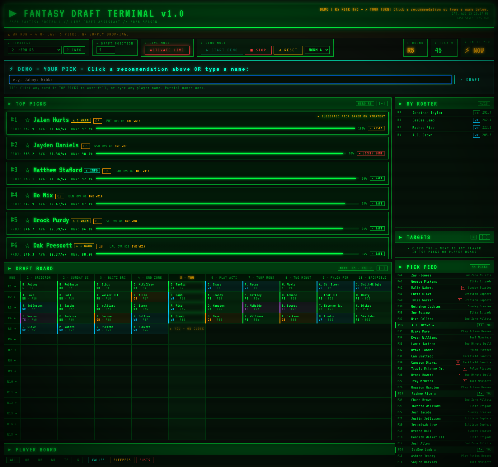

# FANTASY FOOTBALL TERMINAL

A CRT-styled live draft assistant for ESPN fantasy football leagues. Connects to
your league through the ESPN API, tracks picks as they happen, and recommends who
to take next based on the draft strategy you choose.



*Mid-draft in demo mode: strategy-driven recommendations with snipe-risk verdicts,
the live snake board, roster tracking, and the pick feed with grades and roasts.*

It boots like the machine it pretends to be:

```
> BIOS v2.6.1 - FANTASY FOOTBALL SYSTEMS INC.
> MEMORY TEST: 640K OK [OK]
> INITIALIZING ESPN API INTERFACE...
> CROSS-REFERENCING LEAGUE CHAMPIONSHIP DATA...
> HERO QB WIN COUNT: 0. STILL LOADING ANYWAY.
> ALL SYSTEMS NOMINAL. [OK]
> THIS TERMINAL ACCEPTS NO RESPONSIBILITY FOR YOUR PICKS
```

---

## Features

- **Live pick tracking** — polls your ESPN draft every 5 seconds; player
  projections and injury status re-pull every 10 minutes so a long session
  doesn't drift out of date
- **Snake draft board** — full teams × rounds grid, color-coded by position, with
  your column highlighted and the current pick flagged
- **Seven draft strategies** — League History, Hero RB, Balanced BPA, Late-Round QB,
  Robust RB, Zero-RB, and Hero QB, each with a round-by-round blueprint
- **Pick recommendations** — scored by projection, positional need, and your chosen
  strategy, with VALUE / BUST / SLEEPER tags
- **Snipe risk** — tells you whether a player is likely to survive until your next
  turn (SAFE / RISKY / LIKELY GONE), plus a "picks until you" countdown
- **Conflict engine** — flags bye-week stacks, same-position bye collisions, team
  stacks, tough playoff schedules, and roster-construction mistakes
- **Target list** — star players to watch; they get marked SNIPED when taken
- **Demo mode** — simulate a full draft against opponents that draft by value over
  replacement, to rehearse before the real thing
- **Season planner** — after the draft, a week-by-week outlook built from your live
  ESPN roster: the optimal lineup for every week, bye-week clusters, and weeks
  where you cannot field a legal starter at some position

---

## Requirements

- Python 3.9 or newer
- An ESPN fantasy football league you're a member of

---

## Setup

### 1. Install

```bash
git clone <your-repo-url>
cd Fantasy-Football-Terminal
python3 -m venv env
env/bin/pip install -r requirements.txt
```

On Windows, `START_DRAFT.bat` does all of this for you — just double-click it.
Install Python from [python.org](https://www.python.org/downloads/) first, and
check **"Add Python to PATH"** during install.

### 2. League setup

Open `server.py` and fill in the Config block near the top:

```python
LEAGUE_ID    = 0      # the number in your ESPN league URL
YEAR         = 2026   # season year
ESPN_S2      = ''     # your espn_s2 cookie
SWID         = ''     # your SWID cookie (keep the braces)
MY_TEAM_ID   = 1      # your team's ID within the league
TOTAL_TEAMS  = 10
TOTAL_ROUNDS = 15
```

**Finding your cookies:** log into espn.com in Chrome, press `F12` →
**Application** → **Cookies** → `https://www.espn.com`, then copy the values of
`espn_s2` and `SWID`.

> ⚠️ **These cookies authenticate your ESPN account.** Never commit real values to
> a public repository, and rotate them (log out and back in) if they leak.

### 3. Roster settings

The default roster model is QB 1 / RB 2 / WR 2 / TE 1 / FLEX 2 / K 1. If your
league differs, edit `STARTER_NEEDS` in `server.py`.

### 4. League history (optional)

The **LEAGUE HISTORY** strategy is built from past champion drafts in the
`LEAGUE_HISTORY` block of `server.py`. It ships with example data — replace it
with your own league's results to make the strategy meaningful, or pick a
different strategy.

---

## Running

```bash
env/bin/python server.py
```

Then open <http://localhost:8888>. On Windows, double-click `START_DRAFT.bat`
(and `STOP_DRAFT.bat` to stop it).

---

## Draft day

1. Start the app and wait for the board to load
2. **Set your draft position** once it's announced — the countdown, board column,
   and snipe verdicts all depend on it
3. **Select a strategy** (click `? INFO` for its full blueprint)
4. Click **ACTIVATE LIVE** when the draft begins — it stays red until you do
5. Watch the pick feed; the screen flashes when you're on the clock

Picks refresh every 5 seconds. Projections and injury status refresh every 10
minutes (tune `BOARD_REFRESH_SECONDS` in `server.py`).

This tool is **read-only**. It never submits a pick. Whoever runs your draft still
enters every selection — call out your pick, then let the terminal catch up.

---

## After the draft

The **SEASON PLANNER** panel builds a week-by-week outlook from your live ESPN
roster. Click the &#8635; button in its header to load it.

Each week gets a card showing the projected total and its status:

| Status | Meaning |
|--------|---------|
| **FULL** | Everyone available, no byes |
| **n BYE** | Some players out, lineup still legal |
| **✖ NO \<POS\>** | You cannot field a legal starter at that position — stream from waivers |

Click any week to see the optimal lineup for it, who's on bye, and which slots
can't be filled. Playoff weeks are marked. Use it in the first week of the season
to find your problem weeks early, while the waiver wire is still deep.

For any week with an unfillable slot, the planner also lists **waiver targets** —
the best available free agents at that position who are *not* themselves on bye
that week, with projected points and ownership so you can judge how urgently you
need to claim them.

---

## Strategies

| # | Strategy | Best for |
|---|----------|----------|
| 1 | **League History** | Built from your own league's champion patterns |
| 2 | **Hero RB** | One elite RB, then stack WRs — the balanced default |
| 3 | **Balanced BPA** | Best player available, need as tiebreak |
| 4 | **Late-Round QB** | RB/WR for seven rounds, QB in R8–12 |
| 5 | **Robust RB** | Two or three RBs early; good from late snake slots |
| 6 | **Zero-RB** | WR/TE early, RB volume from R5 — high variance |
| 7 | **Hero QB** | Elite QB in R1 — contrarian, highest risk |

Sources: FantasyPros, The Ringer (Danny Heifetz), DraftSharks (Jared Smola, Shane
Hallam), Establish the Run, Shawn Siegele (RotoViz), JJ Zachariason.

---

## Player tags

| Tag | Meaning |
|-----|---------|
| 🟢 **VALUE** | Expert rank beats ADP — draft earlier than the crowd expects |
| 🔴 **BUST** | Publicly overvalued — let someone else overpay |
| 🟡 **SLEEPER** | Late-round upside dart — target rounds 11–14 |

---

## Troubleshooting

**Browser opens but shows an error** — wait ten seconds and refresh; the board
takes a moment to load on first run.

**Picks not updating** — make sure ACTIVATE LIVE is on. If it's still stuck, your
ESPN cookies have probably expired; refresh them per step 2 above.

**Port 8888 already in use** — stop the existing server first (`STOP_DRAFT.bat` on
Windows), then restart.

**Connection errors on startup** — check `LEAGUE_ID`, `ESPN_S2`, and `SWID` are
filled in and that you're a member of that league.

---

## Brokerage Ring (side project)

`brokerage_ring.html` shows a brokerage account as a ring. Each holding is a slice
sized by its share of the account, with its ticker in a pill around the outside:
green when the stock is up from yesterday's close, red when it's down. Pills,
slices and bars are shaded in five fixed steps like a heatmap (under 0.25%,
0.25–0.5%, 0.5–1%, 1–2%, 2%+): gains run yellow-green to deep teal, losses salmon
to maroon, so a shade always means the same size of move. A legend
under the ring explains each mark.

- **Order:** tickers run clockwise from the lowest move to the highest. Gainers
  pull together around 12 o'clock like magnets; losers are pushed away, leaving a
  gap on each side of the green block. Two tickers only trade places once one
  clearly leads, so near-ties don't flicker.
- **Sizing:** slices are each holding's true share of the account, or switch to
  square-root sizing, or cap any slice at 15% (the spare room goes to the others
  and capped slices get a dashed edge), so one big position doesn't crowd out
  the rest. The table and readouts still show true weights.
- **% change or $ impact:** bars and order follow either each holding's own %
  move or what it did to your account in dollars.
- **Thickness** is trading volume: shares traded today against a normal day at
  the same point in the session (20-day average, weighted for the busier open and
  close). A dashed circle marks normal volume.
- **Cash** is a neutral slice. Positions under 1% are grouped as **Other**; click
  it (or "Show separately") to break it out.
- **Benchmark:** the center shows SPY's day and how far ahead or behind you are.
- **Pulses:** when a holding changes shade (including flipping between up and
  down) its slice flashes and a halo in the new shade spreads out, and its pill
  pulses. A pill also pulses when volume passes 2x normal. A holding right on a
  step boundary keeps its shade until it's clearly past it, so it doesn't flicker.

- **Indicator** menus: pick up to two at once (they use different parts of the
  ring, so they layer: e.g. momentum tails + VWAP notches, or signal badges + a
  custom rule side by side). Worked out from today's minute-by-minute
  prices in live mode and from daily closes in replay:
  - *Momentum tails:* a comet tail behind each pill, longer = faster move over the
    last 15 minutes (5 days in replay).
  - *Day range:* a notch across each slice, inner edge = today's low, outer = high
    (20-day range in replay).
  - *VWAP distance:* a notch against a dashed middle line at VWAP, edges ±1%
    (20-day volume-weighted average in replay).
  - *Signal badges:* ▲/▼ when price recently crossed VWAP, ◆ RSI 70+, ◇ RSI 30 or less.
  - *Alert shapes:* the pill turns pointed when volume is 2x normal and the move is 1%+.
  - *Breadth dial:* a gauge in the center, holdings trading above VWAP.
  - *Custom rule:* type a condition using `pct usd rvol weight mom range vwap rsi
    streak spy` (e.g. `pct - spy > 1`, `rsi < 30 && rvol > 1.5`); matching holdings
    get a ★ badge and a pointed pill.

**Live** follows prices through the trading day with spring physics, so small
price changes show up as a gentle drift. Drag the line under the ring (or use
the arrow keys) to rewind today; "Back to live" returns. Pre-market and
after-hours prices are shown dimmed with dashed pills.

```
cp holdings.example.csv holdings.csv     # then edit: ticker,shares (+ a CASH row)
pip install -r requirements.txt
python brokerage_server.py --check       # one fetch, printed as a table
python brokerage_server.py               # → http://localhost:8889
```

Instead of maintaining `holdings.csv`, point `HOLDINGS_FILE` at a positions export
from your brokerage. The header row is found automatically; Symbol / Quantity /
Market Value style columns are recognised, money-market and "Cash & Cash
Investments" rows count as cash, totals rows are skipped, and the same symbol
across accounts is added together. The file is re-read on every poll, so saving a
fresh export updates the ring. (Tested against sample layouts, not every broker's
real file; `--check` shows what was read.)

| Setting | What it does |
| --- | --- |
| `QUOTES_PROVIDER=yahoo` | Default. Yahoo Finance chart API, no key. Unofficial, and some quotes are delayed. Includes pre/after-market prices and volume. |
| `QUOTES_PROVIDER=finnhub` + `FINNHUB_API_KEY` | Finnhub quotes. The free tier allows 60 calls a minute, so polling slows down for large portfolios. No volume or extended hours. |
| `QUOTES_PROVIDER=sim` | Made-up prices, for trying it out offline. `SIM_PHASE=pre`, `post`, `closed` or `half` forces a market phase. |
| `BENCHMARK` | Ticker to compare against (default `SPY`; empty turns it off). |
| `HOLDINGS_FILE` | Holdings or brokerage export to read (default `holdings.csv`). |

Market hours follow the NYSE calendar: weekends, the ten regular holidays and the
1:00 PM early closes. One-off closures aren't known in advance. Quotes refresh
every 15 seconds in the regular session and every minute before and after it.
After the close the server saves the day's prices and volume to
`brokerage_history.csv`. `holdings.csv` and the history file are git-ignored.

**Daily replay** steps through closing values day by day, from the saved history,
a CSV you load (`date,ticker,value` or `date,ticker,shares,price`, optional
`volume`; a `CASH` row is cash and `$SPY` rows are the benchmark), or sample data.
Opening the HTML file directly, without the server, plays a simulated trading day
including pre-market and after-hours.

---

## Notes

Projections come from ESPN's own player data. Bye weeks and playoff strength-of-
schedule are hardcoded for the 2026 season in `server.py` and will need updating
for future seasons.

Built with FastAPI and [espn-api](https://github.com/cwendt94/espn-api).
